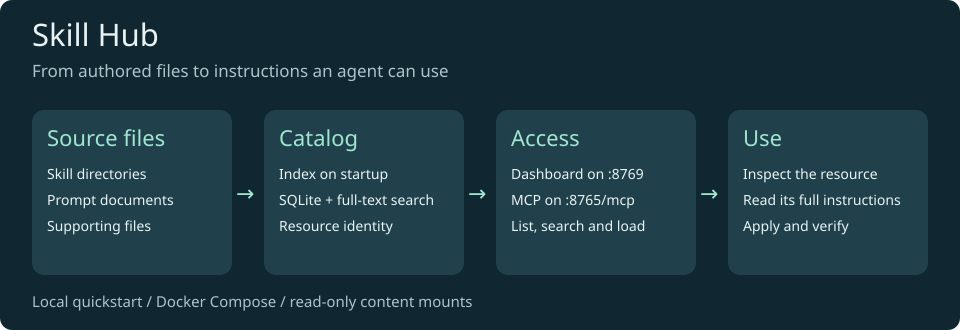

# Skill Hub

Skill Hub is a local catalog for reusable AI skills and prompts. Browse the catalog in a web dashboard, or connect an MCP client to search and load instructions on demand. The Docker build includes Rust libraries for file-reference scanning, metadata matching, and similarity scoring.



## Repository map

| Directory | Responsibility |
| --- | --- |
| [deploy/skill-hub](deploy/skill-hub) | MCP service, catalog, resource loading and Rust helpers |
| [src/hub-dashboard](src/hub-dashboard) | Dashboard API and browser interface |
| [deploy/hub-dashboard](deploy/hub-dashboard) | Dashboard container and startup configuration |
| [examples/hub](examples/hub) | Runnable sample skill and prompt |
| [scripts](scripts) | MCP quickstart checks |

## Run locally

Install Docker with Compose v2.20.0 or later. From a terminal:

```sh
git clone https://github.com/hazasaki/skill-hub.git
cd skill-hub
docker compose up --build -d
```

Open **http://127.0.0.1:8769** for the dashboard. Configure a Streamable HTTP MCP connection to **http://127.0.0.1:8765/mcp**. The first build downloads the container images and dependencies. The included example catalog runs locally without an API key.

Try listing skills in your MCP client, then load one of the returned names with `get_skill`. For prompts, use `search_prompts` and `get_prompt`. The service health endpoint is `http://127.0.0.1:8765/health`.

## Add your own content

Start with the examples under [examples/hub](examples/hub). Each skill lives in `skills/<name>/SKILL.md`. Put its supporting files in that skill directory. Prompt documents live in `prompts/`. Copy an example, give it a unique name and description, and replace its instructions. Include only material you have permission to share.

For a private collection, copy the example tree into the git-ignored `my-hub/` folder and set `SKILL_HUB_CONTENT_DIR=./my-hub` in a local `.env` file. Both services mount your content read-only.

To use a folder elsewhere, set `SKILL_HUB_CONTENT_DIR` in a local `.env` file to the directory containing your `skills` and `prompts` folders. To rebuild the catalog after editing, run:

```sh
docker compose up -d --force-recreate
```

## Operations

- View startup logs with `docker compose logs --tail 100`.
- Stop this installation with `docker compose down`.
- Skills are instructions and can refer to scripts. Review material from other authors before you ask an agent to use it. The default services bind to the local machine.
- The sample catalog is included in this repository. Larger private collections, trained retrieval indexes and model provider credentials are supplied separately by their owners.

## Tiếng Việt

Cài Docker có Compose v2.20.0 trở lên, tải repo và chạy ba lệnh trong mục **Run locally**. Mở dashboard ở cổng **8769**, hoặc kết nối ứng dụng MCP với đường dẫn **/mcp** ở cổng **8765**. Bạn có thể thêm skill và prompt theo mẫu trong `examples/hub`, rồi chạy lại lệnh dựng catalog ở trên.

## Credits

Codex contributed to implementation, regression testing, architecture documentation and release preparation.

## License

Skill Hub and its bundled examples are distributed under the [MIT License](LICENSE). Imported content and third-party dependencies retain their respective licenses.
