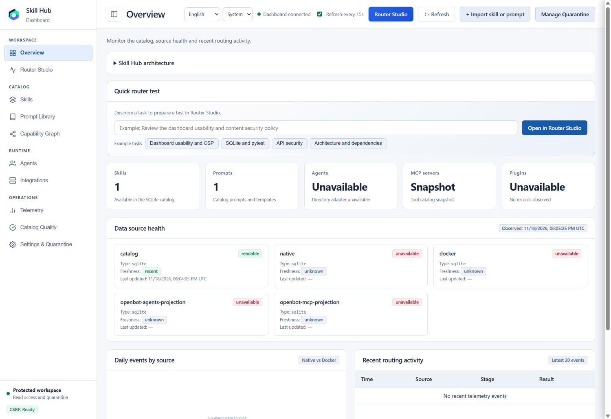
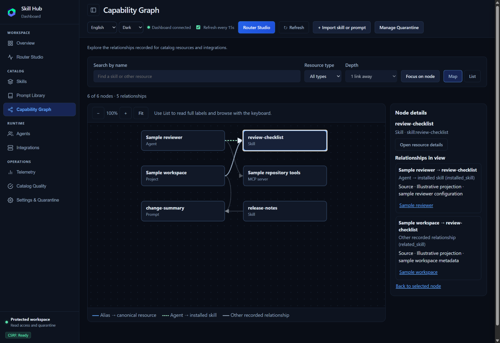

# Skill Hub

Skill Hub gives an AI agent a local catalog of reusable skills and prompts. Browse the catalog in the dashboard, or let an MCP client describe a task and choose which instructions to load.


With model routing configured, `route_task` returns a menu of matching resources. The agent can skip the menu or request an entry with `load_resource_choice`, passing the ID and hashes from the menu. The Hub checks permissions, dependencies and content hashes before returning the selected instructions. Direct catalog browsing also works without a model provider.

[Release notes](CHANGELOG.md) · [Provider setup](deploy/skill-hub/README.md)

## Dashboard preview





The overview uses the bundled public Markdown catalog. The graph adds a sample projection to illustrate relationship evidence.


The Dashboard starts in English and follows your system appearance. You can
switch to Vietnamese or select Light or Dark. The capabilities view lets you
find a resource by name, focus its neighbors and read the evidence for each
relationship. Use the list view to explore relationships with the keyboard.
[Dashboard guide](src/hub-dashboard/static/README.md)

## Repository map

| Directory | Responsibility |
| --- | --- |
| [deploy/skill-hub](deploy/skill-hub) | MCP service, catalog, resource loading and Rust helpers |
| [src/hub-dashboard](src/hub-dashboard) | Dashboard API and browser interface |
| [deploy/hub-dashboard](deploy/hub-dashboard) | Dashboard container and startup configuration |
| [examples/hub](examples/hub) | Runnable sample skill and prompt |
| [scripts](scripts) | MCP quickstart checks |

## Run locally

Install Docker with Compose v2.20.0 or later. From a terminal:

```sh
git clone https://github.com/hazasaki/skill-hub.git
cd skill-hub
docker compose up --build -d
```

Open **http://127.0.0.1:8769** for the Dashboard. Configure a Streamable HTTP MCP
connection to **http://127.0.0.1:8765/mcp**. The first build downloads the container
images and dependencies. The included example catalog runs locally without an API
key. Open the capabilities view to browse its resources. Graph relationships
depend on the sources available to your installation.

Try listing skills in your MCP client, then load one of the returned names with `get_skill`. For prompts, use `search_prompts` and `get_prompt`. The service health endpoint is `http://127.0.0.1:8765/health`.

For optional model routing with Liquid D1 or Baseten, see the [provider setup](deploy/skill-hub/README.md#optional-model-routing).

## Add your own content

Start with the examples under [examples/hub](examples/hub). Each skill lives in `skills/<name>/SKILL.md`. Put its supporting files in that skill directory. Prompt documents live in `prompts/`. Copy an example, give it a unique name and description, and replace its instructions. Include only material you have permission to share.

For a private collection, copy the example tree into the git-ignored `my-hub/` folder and set `SKILL_HUB_CONTENT_DIR=./my-hub` in a local `.env` file. Both services mount your content read-only.

To use a folder elsewhere, set `SKILL_HUB_CONTENT_DIR` in a local `.env` file to the directory containing your `skills` and `prompts` folders. To rebuild the catalog after editing, run:

```sh
docker compose up -d --force-recreate
```

## Operations

- View startup logs with `docker compose logs --tail 100`.
- Stop this installation with `docker compose down`.
- Skills are instructions and can refer to scripts. Review material from other authors before you ask an agent to use it. The default services bind to the local machine.
- The sample catalog is included in this repository. Larger private collections, trained retrieval indexes and model provider credentials are supplied separately by their owners.

## Tiếng Việt

Cài Docker có Compose v2.20.0 trở lên, tải repo và chạy ba lệnh trong mục **Run locally**. Mở dashboard ở cổng **8769**, hoặc kết nối ứng dụng MCP với đường dẫn **/mcp** ở cổng **8765**. Bạn có thể thêm skill và prompt theo mẫu trong `examples/hub`, rồi chạy lại lệnh dựng catalog ở trên. Chọn **Tiếng Việt** trong phần ngôn ngữ của Dashboard.
Chọn **Sáng**, **Tối** hoặc **Hệ thống** để đổi giao diện.

## Credits

Codex contributed to implementation, regression testing, architecture documentation and release preparation.

## License

Skill Hub and its bundled examples are distributed under the [MIT License](LICENSE). Imported content and third-party dependencies retain their respective licenses.
